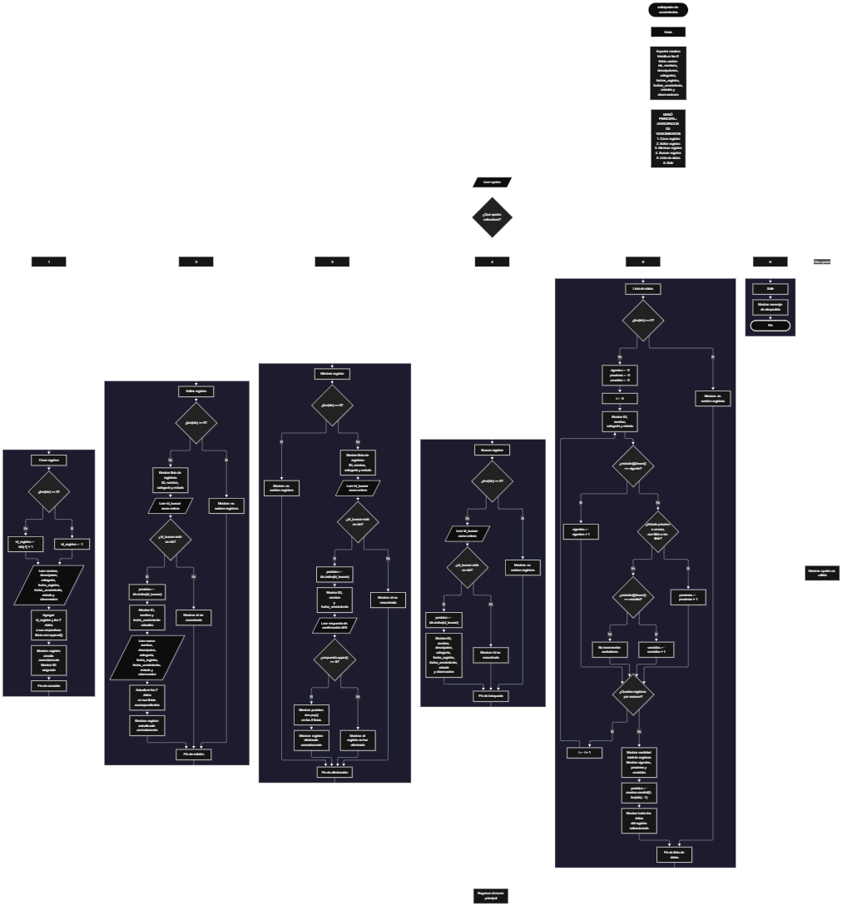

Este proyecto, llamado <b>anticipador de vencimientos</b>, fue desarrollado en <b>python</b> como un ejercicio práctico para fortalecer la lógica de programación mediante la creación de un sistema de gestión de registros desde la consola. El programa cuenta con un menú principal de seis opciones que permite <b>crear, editar, eliminar, buscar y listar registros</b>, además de consultar información completa mediante la búsqueda de un registro específico. Cada registro almacena datos como el nombre, la descripción, la categoría, la fecha de registro, la fecha de vencimiento, el estado y las observaciones, utilizando ocho listas paralelas que mantienen organizada la información durante la ejecución. El sistema también presenta estadísticas sobre la cantidad de registros vigentes, próximos a vencer y vencidos, y selecciona aleatoriamente un registro para mostrar todos sus datos. Durante su desarrollo se aplicaron conceptos fundamentales de programación, como variables, listas, estructuras condicionales, ciclos repetitivos, métodos de listas, contadores y selección aleatoria. Este proyecto permite poner en práctica los conocimientos adquiridos en Python y sirve como base para desarrollar sistemas de gestión más avanzados utilizando otros lenguajes y tecnologías.

<h2 align="center">⚙️ Funcionamiento del menú principal</h2>

### ➕ Crear registro

La opción <b>1) crear registro</b> permite registrar un nuevo elemento en el anticipador de vencimientos. Antes de solicitar los datos, el programa comprueba si la lista <b>ids</b> está vacía mediante la condición <b>len(ids) == 0</b>. Si no existen registros, asigna el identificador <b>1</b> a la variable <b>id_registro</b>. En caso contrario, genera el nuevo identificador sumando uno al último ID almacenado mediante la expresión <b>ids[-1] + 1</b>. Después, solicita el <b>nombre, descripción, categoría, fecha de registro, fecha de vencimiento, estado y observación</b>. Los datos se almacenan en sus respectivas listas mediante el método <b>append()</b>, manteniendo la misma posición para todos los campos de un registro. Finalmente, muestra el mensaje <b>"registro creado correctamente."</b> y presenta el identificador asignado. El estado solicitado puede ser vigente, próximo a vencer o vencido, aunque el programa no comprueba que el valor introducido corresponda a alguna de estas opciones.

### ✏️ Editar registro

La opción <b>2) editar registro</b> permite modificar la información de un registro existente. Primero, el programa comprueba si la lista <b>ids</b> está vacía. Si no hay registros almacenados, muestra el mensaje <b>"no existen registros."</b>. En caso contrario, presenta una lista resumida con el ID, nombre, categoría y estado de cada registro. Después, solicita el identificador que se desea editar y lo convierte a un número entero mediante <b>int()</b>. Si el identificador se encuentra en la lista <b>ids</b>, utiliza <b>ids.index(id_buscar)</b> para obtener la posición correspondiente. A continuación, muestra el ID, nombre y fecha de vencimiento actuales, y solicita los nuevos valores del nombre, descripción, categoría, fecha de registro, fecha de vencimiento, estado y observación. Cada dato se actualiza directamente en su lista correspondiente mediante la posición encontrada. Finalmente, muestra el mensaje <b>"registro actualizado correctamente."</b>. Si el ID introducido no existe, presenta el mensaje <b>"id no encontrada."</b>.

### 🗑️ Eliminar registro

La opción <b>3) eliminar registro</b> permite eliminar un registro mediante su identificador. Primero, el programa comprueba si existen registros almacenados. Si la lista <b>ids</b> está vacía, muestra el mensaje <b>"no existen registros."</b>. Si hay registros disponibles, presenta una lista con el ID, nombre, categoría y estado de cada uno. Después, solicita el identificador que se desea eliminar y comprueba si se encuentra en la lista <b>ids</b>. Si existe, utiliza <b>ids.index(id_buscar)</b> para determinar su posición y muestra el ID, nombre y fecha de vencimiento del registro seleccionado. A continuación, solicita confirmación mediante la pregunta <b>"¿desea eliminar este registro? (s/n):"</b>. Si la respuesta convertida a mayúsculas mediante <b>respuesta.upper()</b> es igual a <b>"S"</b>, utiliza el método <b>pop(posicion)</b> para eliminar los datos correspondientes de las ocho listas: <b>ids, nombres, descripciones, categorias, fechas_registro, fechas_vencimiento, estados y observaciones</b>. Finalmente, muestra el mensaje <b>"registro eliminado correctamente."</b>. Si el usuario no confirma la operación, presenta el mensaje <b>"el registro no fue eliminado."</b>. Si el identificador no existe, muestra el mensaje <b>"id no encontrada."</b>.

### 🔎 Buscar registro

La opción <b>4) buscar registro</b> permite localizar un registro mediante su identificador. Primero, el programa comprueba si existen registros almacenados en la lista <b>ids</b>. Si no hay registros, presenta el mensaje <b>"no existen registros."</b>. En caso contrario, solicita el ID que se desea buscar y convierte el valor introducido a un número entero mediante <b>int()</b>. Si el identificador existe en la lista, utiliza <b>ids.index(id_buscar)</b> para encontrar la posición del registro. A continuación, muestra todos sus datos: <b>ID, nombre, descripción, categoría, fecha de registro, fecha de vencimiento, estado y observación</b>. Si el identificador no se encuentra entre los registros almacenados, presenta el mensaje <b>"id no encontrada."</b>. Esta operación permite consultar la información completa de un registro sin modificar los datos almacenados.

### 📋 Lista de datos

La opción <b>5) lista de datos</b> permite visualizar los registros existentes y consultar las estadísticas del anticipador de vencimientos. Primero, el programa comprueba si la lista <b>ids</b> está vacía. Si no existen registros, muestra el mensaje <b>"no existen registros."</b>. En caso contrario, inicializa los contadores <b>vigentes, proximos y vencidos</b> con el valor cero. Después, utiliza un ciclo <b>for</b> para recorrer las posiciones de las listas y mostrar el ID, nombre, categoría y estado de cada registro. Durante el recorrido, compara el estado almacenado en la lista <b>estados</b> utilizando el método <b>lower()</b>. Si el estado es <b>"vigente"</b>, incrementa el contador de vigentes; si es <b>"próximo a vencer"</b> o <b>"proximo a vencer"</b>, incrementa el contador de próximos a vencer; y si es <b>"vencido"</b>, incrementa el contador de vencidos. Al finalizar el recorrido, presenta la cantidad total de registros mediante <b>len(ids)</b> y muestra los tres contadores. Finalmente, utiliza <b>random.randint(0, len(ids) - 1)</b> para seleccionar una posición aleatoria y muestra todos los datos del registro seleccionado. Esta función permite consultar el estado general de los registros y visualizar un ejemplo aleatorio de la información almacenada.

### 🚪 Salir del menú principal

La opción <b>6) salir</b> permite finalizar la ejecución del programa. Cuando el usuario selecciona esta opción, el sistema muestra el mensaje <b>"gracias por utilizar el anticipador de vencimientos."</b> y ejecuta la instrucción <b>break</b>, que termina el ciclo <b>while True</b> del menú principal. De esta manera, el usuario puede finalizar la ejecución después de crear, editar, eliminar, buscar o consultar los registros. Los datos se almacenan únicamente en las listas durante la ejecución, por lo que no se conservan automáticamente cuando el programa termina.

<h2 align="center">🧠 Temas aplicados en el proyecto</h2>

### 📦 Variables

En este proyecto se utilizan variables para almacenar la opción seleccionada en el menú principal, generar identificadores, recibir los datos introducidos por el usuario, localizar registros y controlar los contadores estadísticos. También se emplean variables auxiliares para almacenar la posición de un registro, la respuesta a la confirmación de eliminación y los resultados de la selección aleatoria. Cada variable cumple una función específica dentro de las operaciones de gestión de vencimientos.

🔢 **opcion:** Almacena la opción introducida por el usuario en el menú principal.

🆔 **id_registro:** Almacena el identificador asignado al nuevo registro.

🔎 **id_buscar:** Almacena el identificador introducido para buscar, editar o eliminar un registro.

📍 **posicion:** Almacena el índice utilizado para acceder a los datos correspondientes de las listas.

📝 **nombre, descripcion, categoria:** Almacenan temporalmente los datos introducidos durante la creación de un registro.

📅 **fecha_registro, fecha_vencimiento:** Almacenan las fechas introducidas por el usuario.

📌 **estado, observacion:** Almacenan el estado y las observaciones del registro.

🔄 **i:** Funciona como variable de recorrido en los ciclos <b>for</b> utilizados para mostrar los registros y calcular las estadísticas.

📊 **vigentes, proximos, vencidos:** Almacenan las cantidades de registros clasificados en cada uno de los tres estados reconocidos.

🎲 **respuesta:** Almacena la respuesta del usuario durante la confirmación de eliminación.

### 🗃️ Listas

En este proyecto se utilizan ocho listas paralelas para almacenar los datos de los registros. Cada lista contiene un campo específico y utiliza el mismo índice para relacionar la información de un mismo registro. Por ejemplo, los datos del registro ubicado en la posición <b>0</b> se encuentran distribuidos entre <b>ids[0], nombres[0], descripciones[0], categorias[0], fechas_registro[0], fechas_vencimiento[0], estados[0] y observaciones[0]</b>. Esta organización permite recorrer, buscar, modificar, mostrar y eliminar registros manteniendo la correspondencia entre todos sus campos.

🆔 **ids:** Almacena los identificadores de los registros.

📝 **nombres:** Almacena los nombres de los elementos registrados.

📄 **descripciones:** Almacena las descripciones de los registros.

🗂️ **categorias:** Almacena las categorías asignadas a cada registro.

📅 **fechas_registro:** Almacena las fechas de registro.

⏳ **fechas_vencimiento:** Almacena las fechas de vencimiento.

📌 **estados:** Almacena el estado introducido para cada registro.

🗒️ **observaciones:** Almacena las observaciones adicionales.

### 🔀 Estructuras condicionales

En este proyecto se utilizan las estructuras <b>if, elif y else</b> para controlar las operaciones del menú principal y determinar qué acciones deben ejecutarse según las condiciones de cada registro. Estas estructuras permiten comprobar si existen registros almacenados, decidir cómo generar el siguiente identificador, verificar si un ID se encuentra en la lista, confirmar una eliminación y clasificar los registros según sus estados. También permiten mostrar el mensaje <b>"opción no válida."</b> cuando el usuario introduce una opción que no corresponde a las definidas en el menú.

### 🔄 Estructuras repetitivas

En este proyecto se utilizan los ciclos <b>while</b> y <b>for</b>. El ciclo <b>while True</b> mantiene activo el menú principal y permite realizar diferentes operaciones hasta que se selecciona la opción de salida. Por otro lado, los ciclos <b>for</b> recorren las listas para mostrar los registros existentes y calcular las estadísticas según sus estados. El uso de estas estructuras facilita la repetición de instrucciones y la administración de múltiples registros sin necesidad de escribir las mismas operaciones de forma individual para cada uno.

### 🎯 Selección de opciones

El programa utiliza una estructura condicional formada por <b>if, elif y else</b> para evaluar el contenido de la variable <b>opcion</b>. Cada condición corresponde a una de las seis opciones del menú principal: <b>crear registro, editar registro, eliminar registro, buscar registro, lista de datos y salir</b>. Cuando el usuario selecciona una opción válida, se ejecuta el bloque de instrucciones correspondiente. Si introduce un valor diferente, el programa muestra el mensaje <b>"opción no válida."</b> y vuelve a presentar el menú principal.

### 🔢 Generación de identificadores

El programa genera identificadores para diferenciar los registros almacenados. Cuando la lista <b>ids</b> está vacía, el primer identificador se establece en <b>1</b>. Cuando ya existen registros, utiliza la expresión <b>ids[-1] + 1</b> para obtener el nuevo identificador a partir del último elemento de la lista. Este procedimiento permite asignar identificadores consecutivos durante el funcionamiento habitual del programa. Sin embargo, si se elimina el registro que contiene el identificador más alto, el siguiente registro puede recibir nuevamente ese identificador, debido a que el cálculo depende del último elemento que permanezca almacenado.

### 🔍 Búsqueda y acceso a registros

El programa utiliza el operador <b>in</b> para comprobar si un identificador existe en la lista <b>ids</b>. Cuando encuentra el identificador, utiliza el método <b>index()</b> para obtener la posición del registro. Esta posición permite acceder a los datos correspondientes en las ocho listas paralelas. El procedimiento se aplica durante las operaciones de edición, eliminación y búsqueda, evitando realizar cambios sobre un identificador que no se encuentre almacenado. Si no se encuentra el ID solicitado, el programa presenta el mensaje <b>"id no encontrada."</b>.

### 🔄 Métodos de listas

En este proyecto se utilizan distintos métodos y operaciones de listas para administrar los registros. El método <b>append()</b> agrega los datos al final de cada lista durante la creación de un registro. El método <b>index()</b> permite encontrar la posición de un identificador existente. El método <b>pop()</b> elimina el elemento ubicado en una posición específica durante la eliminación de un registro. Además, se utilizan <b>len()</b> para conocer la cantidad de registros almacenados y el índice negativo <b>-1</b> para acceder al último identificador de la lista. Estas operaciones facilitan la administración dinámica de los registros durante la ejecución.

### 📊 Contadores y estadísticas

El programa utiliza los contadores <b>vigentes, proximos y vencidos</b> para calcular la cantidad de registros que pertenecen a cada estado reconocido. Al iniciar la opción de lista de datos, los tres contadores se establecen en cero. Después, un ciclo <b>for</b> recorre los estados almacenados y utiliza comparaciones condicionales para incrementar el contador correspondiente. La comparación mediante <b>lower()</b> permite reconocer los estados escritos con mayúsculas o minúsculas, mientras que la condición del estado próximo a vencer admite tanto la versión con tilde como la versión sin tilde. Finalmente, el programa presenta la cantidad total de registros y los resultados de cada contador. Los estados distintos de los tres esperados no se incluyen en estas categorías.

### 🎲 Selección aleatoria

El programa importa el módulo <b>random</b> para seleccionar aleatoriamente uno de los registros almacenados. En la opción de lista de datos, utiliza la instrucción <b>random.randint(0, len(ids) - 1)</b> para generar una posición comprendida entre el primer índice y el último índice disponible. La posición obtenida se almacena en la variable <b>posicion</b> y permite mostrar el ID, nombre, descripción, categoría, fecha de registro, fecha de vencimiento, estado y observación del registro seleccionado. Esta operación se realiza únicamente cuando existen registros, debido a que el programa comprueba previamente si la lista <b>ids</b> está vacía.

<h2 align="center">¿Cómo se implementaron las operaciones crud en el proyecto?</h2>

Las operaciones <b>crud</b> se implementaron mediante las opciones del menú principal para administrar los registros del anticipador de vencimientos. La operación <b>crear</b> corresponde a <b>crear registro</b>, donde se introducen los datos y se almacenan en las ocho listas. La operación <b>leer</b> se realiza mediante <b>buscar registro y lista de datos</b>, que permiten consultar la información completa de un registro y visualizar los registros junto con sus estadísticas. La operación <b>actualizar</b> corresponde a <b>editar registro</b>, donde se modifican los campos de un registro existente. Finalmente, la operación <b>eliminar</b> se realiza mediante <b>eliminar registro</b>, que solicita confirmación y elimina los datos correspondientes de todas las listas. Estas operaciones utilizan identificadores, posiciones, condicionales y métodos de listas para gestionar la información almacenada temporalmente durante la ejecución del programa.

<h2 align="center">Diagrama de flujo del proyecto</h2>

<h2 align="center">🛡️ Validaciones del programa</h2>

### 📭 No existen registros

Esta comprobación se utiliza en las opciones de <b>editar registro, eliminar registro, buscar registro y lista de datos</b>. El programa comprueba si la lista <b>ids</b> tiene una longitud igual a cero mediante la condición <b>len(ids) == 0</b>. Si no existen registros almacenados, muestra el mensaje <b>"no existen registros."</b> y evita continuar con las operaciones que necesitan información disponible. Esta comprobación también evita que la selección aleatoria intente obtener una posición cuando no existen registros.

### ❌ Identificador no encontrado

Esta comprobación se utiliza durante las operaciones de edición, eliminación y búsqueda. El programa verifica si el valor de <b>id_buscar</b> se encuentra en la lista <b>ids</b> mediante la condición <b>id_buscar in ids</b>. Si el identificador existe, obtiene su posición con <b>ids.index(id_buscar)</b> y continúa con la operación solicitada. Si no existe, muestra el mensaje <b>"id no encontrada."</b>. De esta manera, el programa diferencia los identificadores registrados de aquellos que no se encuentran almacenados.

### 🗑️ Confirmación de eliminación

Esta comprobación se utiliza antes de eliminar un registro. El programa solicita al usuario una respuesta y la convierte a mayúsculas mediante <b>respuesta.upper()</b>. Si el resultado es igual a <b>"S"</b>, elimina los elementos correspondientes de las ocho listas y presenta el mensaje <b>"registro eliminado correctamente."</b>. Si la respuesta es diferente de <b>"S"</b>, conserva los datos y muestra el mensaje <b>"el registro no fue eliminado."</b>. Esta condición permite confirmar la operación antes de modificar las listas.

### 📌 Clasificación de estados

La clasificación de estados se realiza en la opción de lista de datos. El programa utiliza <b>estados[i].lower()</b> para comparar cada estado sin distinguir entre mayúsculas y minúsculas. Los valores reconocidos son <b>"vigente"</b>, <b>"próximo a vencer"</b>, <b>"proximo a vencer"</b> y <b>"vencido"</b>. Cada coincidencia incrementa su contador correspondiente. Sin embargo, el programa no valida el estado al crear o editar un registro, por lo que los valores diferentes de los reconocidos no se contabilizan en las estadísticas. La clasificación tampoco se calcula a partir de las fechas, ya que el estado es introducido manualmente por el usuario.

### 📅 Fechas de registro y vencimiento

El programa solicita las fechas de registro y vencimiento durante la creación y edición de los registros. Estos valores se almacenan en las listas <b>fechas_registro</b> y <b>fechas_vencimiento</b>, y se muestran durante las consultas de información completa. Sin embargo, las fechas se guardan como texto y no se realiza una comprobación de su formato, de su validez ni de la relación entre ambas. Tampoco existe una operación automática que determine si un registro está próximo a vencer o vencido. Por tanto, el estado mostrado depende del valor introducido por el usuario.

### ⚠️ Identificadores y entradas del usuario

El programa genera identificadores mediante la lista <b>ids</b> y convierte a números enteros los identificadores introducidos en las operaciones de edición, eliminación y búsqueda mediante <b>int()</b>. Sin embargo, no incluye un control de errores para entradas que no puedan convertirse a enteros. Si el usuario introduce texto no numérico en estos campos, puede producirse un error que interrumpa la ejecución. Además, la generación del siguiente ID depende del último identificador almacenado, por lo que un ID eliminado puede volver a utilizarse cuando se elimina el registro con el identificador más alto.

### ⚠️ Opción no válida

El menú principal incluye una condición <b>else</b> que muestra el mensaje <b>"opción no válida."</b> cuando el usuario introduce un valor diferente de las opciones definidas entre <b>1</b> y <b>6</b>. Después de mostrar el mensaje, el ciclo <b>while True</b> permite que el menú vuelva a presentarse para que el usuario pueda seleccionar otra opción. Esta comprobación controla las opciones del menú, pero no valida todos los datos introducidos en los campos de los registros.

<h2 align="center">🎯 Objetivo del proyecto</h2>

El objetivo principal de este proyecto es fortalecer la <b>lógica de programación</b> mediante el desarrollo de un sistema de gestión de registros en <b>python</b>. A través de su construcción se busca aplicar los conocimientos adquiridos sobre variables, listas, estructuras condicionales, ciclos repetitivos, métodos de listas, contadores y selección aleatoria, integrándolos para resolver un problema de manera organizada. Además, el proyecto permite comprender cómo registrar, consultar, modificar y eliminar información, así como clasificar registros según su estado y presentar estadísticas básicas en una aplicación de consola. De esta manera, establece una base para desarrollar sistemas de seguimiento de vencimientos más avanzados, incorporando posteriormente validaciones de fechas, clasificación automática y almacenamiento persistente cuando sea necesario.

